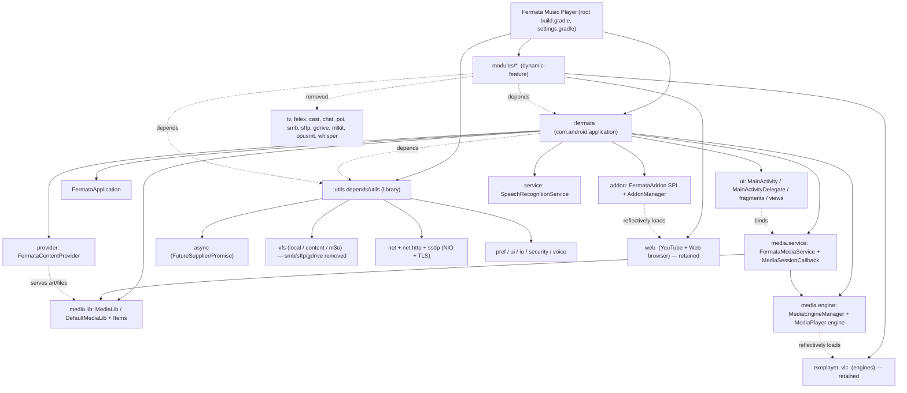

# Fermata Media Player — Knowledge Base

Code-grounded architecture, build, and design documentation for this repository. Claims cite concrete
files (and class/method where applicable); unverifiable items are marked `[UNVERIFIED]` /
`[NEEDS RUNTIME VERIFICATION]`.

> **Maintainer note (for humans and AI editors).** This Knowledge base is a shared **project-context**
> source, meant to be read and acted on quickly. Keep it:
> - **Forward-looking** — describe the current state, not the journey. Drop superseded designs,
>   "what we tried", renamed/removed artifacts, and change-log narration once they no longer apply.
> - **Essential only** — capture important findings and decisions; omit obvious or easily re-derived
>   detail.
> - **To the point & AI-consumable** — short sections, concrete file/symbol references, no duplication
>   across docs (state a fact once, link to it).
> - **No stale info** — *unless* a specific gotcha prevents a future mistake or saves real time
>   (e.g. "`assembleAutoRelease` does not fuse splits — use `packageAutoReleaseUniversalApk`"). Keep
>   such cautions; they earn their place. When behavior changes, update the doc in the same change.
> - **Source is truth** — if a doc disagrees with code, trust the code, fix the doc, note nothing more.

> The `architecture/` docs describe the **full upstream** codebase. This repo is a **slimmed core
> build** — see `PROJECT_STATE.md` for exactly what ships now and `CHANGELOG.md` for how/why it
> differs from upstream. (Context continues below.)

> **Current state:** TV, Felex, Google Cast, ChatGPT, POI, the Subtitle
> generator (whisper/mlkit/opusmt), and the SMB/SFTP/Google-Drive network VFS providers have been
> removed. Retained: **YouTube, Web browser, audio/video playback, local/SAF/M3U file explorer**, and
> the **MediaPlayer/ExoPlayer/VLC** engines. Active Gradle modules: `:fermata`, `:utils`,
> `:exoplayer`, `:vlc`, `:web`. Full detail in `CHANGELOG.md`.

## Folder layout
```
Knowledge/
  README.md                 ← you are here (index)
  AI_KICKSTART_PROMPT.md     ← paste into a new AI thread to bootstrap context
  PROJECT_STATE.md           ← authoritative "what the build is right now"
  BUILD.md                   ← build commands, flags, packaging, signing
  CHANGELOG.md               ← every change applied, with rationale + commit refs
  architecture/              ← how the (full upstream) codebase works
    01_architecture_overview.md
    02_module_breakdown.md
    03_data_flow_and_contracts.md
    04_critical_findings_and_audit.md
    modules/*.md             ← per-module notes (some describe REMOVED modules)
  design/                    ← forward-looking plans
    CORE_HARDENING.md
    ADBLOCKER_DESIGN.md
  patches/                   ← apply-ready git patches + README
```

## Start here
| Doc | What's inside |
|---|---|
| [AI_KICKSTART_PROMPT.md](AI_KICKSTART_PROMPT.md) | **New AI thread? Paste this first.** Persona, full context, build/verify steps, how/when to use each Knowledge file. |
| [PROJECT_STATE.md](PROJECT_STATE.md) | **Authoritative current state.** Built/retained vs removed (removed module dirs still exist on disk but are excluded). Read before trusting `architecture/*`. |
| [BUILD.md](BUILD.md) | Build commands table + their impact, package-ID flags, signing, troubleshooting. |
| [CHANGELOG.md](CHANGELOG.md) | What differs from upstream and **why** (the durable rationale behind each change + recorded decisions). |

## Architecture (`architecture/`)
> ⚠️ These describe the **full upstream** codebase; cross-check against `PROJECT_STATE.md`.

| Doc | What's inside |
|---|---|
| [architecture/01_architecture_overview.md](architecture/01_architecture_overview.md) | System architecture, Gradle module topology, runtime components, integrations, build pipeline. |
| [architecture/02_module_breakdown.md](architecture/02_module_breakdown.md) | File-by-file breakdown of `:fermata` and `:utils`. |
| [architecture/03_data_flow_and_contracts.md](architecture/03_data_flow_and_contracts.md) | End-to-end workflows, ContentProvider/MediaBrowser contracts, preference schemas, SPIs. |
| [architecture/04_critical_findings_and_audit.md](architecture/04_critical_findings_and_audit.md) | Security/crash/perf/debt audit (with post-removal status banner). |

### Per-module docs (`architecture/modules/`)
| Module | Doc | Status |
|---|---|---|
| ExoPlayer engine | [architecture/modules/exoplayer.md](architecture/modules/exoplayer.md) | ✅ retained |
| VLC engine | [architecture/modules/vlc.md](architecture/modules/vlc.md) | ✅ retained |
| Web browser / YouTube | [architecture/modules/web.md](architecture/modules/web.md) | ✅ retained (core) |
| IPTV (TV) | [architecture/modules/tv.md](architecture/modules/tv.md) | ❌ removed |
| Felex (language tutor) | [architecture/modules/felex.md](architecture/modules/felex.md) | ❌ removed |
| Google Cast | [architecture/modules/cast.md](architecture/modules/cast.md) | ❌ removed |
| ChatGPT | [architecture/modules/chat.md](architecture/modules/chat.md) | ❌ removed |
| POI (Android Auto) | [architecture/modules/poi.md](architecture/modules/poi.md) | ❌ removed |
| SMB / SFTP / GDrive VFS | [architecture/modules/vfs-providers.md](architecture/modules/vfs-providers.md) | ❌ removed |
| ML Kit / OPUS-MT / Whisper | [architecture/modules/ai-ml.md](architecture/modules/ai-ml.md) | ❌ removed (subtitle-gen impls) |

## Design / plans (`design/`)
| Doc | What's inside |
|---|---|
| [design/CORE_HARDENING.md](design/CORE_HARDENING.md) | Stabilization plan for the retained core, test matrix, permission review, and the fact-checked playback crash-risk backlog (§10). |
| [design/ADBLOCKER_DESIGN.md](design/ADBLOCKER_DESIGN.md) | Blocklist WebView ad-blocker design. **Includes the expectation-correction: a domain blocklist cannot remove YouTube in-stream video ads.** Not implemented. |

## Patches (`patches/`)
| File | What it does |
|---|---|
| [patches/README.md](patches/README.md) | How to apply the patches. |
| `patches/0001-core-slimming-remove-non-core-features.patch` | Core slimming (removals), `git am`-ready. |
| `patches/0002-ui-internet-toggle-and-favorites-nav.patch` | Internet-access toggle + Favorites nav removal. |

> A single combined patch of the full change-set can be regenerated from git history anytime
> (see `CHANGELOG.md`).

## Quick facts

- **Type:** Native Android media player (audio/video/IPTV). Java 17, min SDK 28, target/compile SDK 36.
- **Version:** `2.0.2` (code `268`) — `gradle/libs.versions.toml`.
- **Language mix:** 450 `.java`, 0 Kotlin, 1 C, 293 non-build XML, 20 `.gradle`.
- **Entry points:** `FermataApplication` · `MainActivity`/`MainActivityDelegate` ·
  `FermataMediaService` · `SpeechRecognitionService` · `FermataContentProvider`.
- **Distribution:** two paths — (1) **direct/sideload:** fused universal APK via
  `fermata:packageAutoReleaseUniversalApk` (engines + addons fused into the base dex; the primary path
  for this fork); (2) **Play:** App Bundle (`.aab`) with install-time dynamic feature modules. See
  `BUILD.md`.
- **Concurrency:** in-house `me.aap.utils.async.FutureSupplier`/`Promise` (no RxJava/coroutines).
- **Build:** sideload `./gradlew fermata:packageAutoReleaseUniversalApk -PABI=arm64-v8a -PAPP_ID_SFX=...`
  (or `./build.sh`); Play `./gradlew bundleAutoRelease -PAPP_ID_SFX=...`. See `BUILD.md`.

## Repository / module map



> The map shows the **current** build. Removed modules (`X`) are retained in the docs for reference;
> see `CHANGELOG.md`. The addon registry (`BuildConfig.ADDONS`) now resolves to:
> `translate` (inert), `subgen` (disabled/hidden), `youtube`, `web_browser`.

## Executive summary (audit)

Fermata is a mature, dependency-light Android media player with a clean SPI-based plugin
architecture (engines + addons shipped as Play dynamic features) built on a large in-house utility
library (`me.aap.utils`) that even reimplements async, NIO networking, and TLS.

Top risks to review (full detail in [architecture/04_critical_findings_and_audit.md](architecture/04_critical_findings_and_audit.md)):

1. 🔴 **Network credentials are stored with fake "encryption"** (hex-encoded UTF-16) in prefs —
   `NetFileSystemBase.java:323-330`. Affects SMB/SFTP passwords & SSH passphrases.
2. 🔴 **SFTP auto-accepts unknown host keys** (jsch `promptYesNo` always `true`) —
   `SftpRoot.java`. No MITM protection.
3. 🟠 **`FermataContentProvider` is exported** and will open caller-supplied `file://` paths or fetch
   caller-supplied `http(s)` URLs — `FermataContentProvider.java::openFile` / manifest.
4. 🟠 **WebView is broadly enabled** (JS + file access + JS bridge + third-party cookies) with
   app-wide cleartext traffic — `FermataWebView.java::init`.
5. 🟠 **Silent error swallowing** on reflective addon/engine loading hides failures —
   `AddonManager.java`, `MediaEngineManager.java`.
6. 🟠 **Testing + large-class debt**: core playback (`MediaSessionCallback` 52 KB,
   `MainActivityDelegate` 1345 lines) is untested.

Note: several high-privilege behaviors (root `su.exec`, `ALLOW_ALL_HOSTS_VALIDATOR`) live only in the
`auto` flavor's opt-in Android-Auto screen-mirroring feature and require a rooted device.

## How this was produced & verified
- Phase 1 inventory: directory walk + per-type file counts + package listing (not a git repo).
- Phase 2: read the root/app/module `build.gradle`, `libs.versions.toml`, the main `AndroidManifest`,
  and all primary runtime classes (Application, MediaService, MediaSessionCallback signatures,
  MediaEngine(Manager), MediaLib, AddonManager, ContentProvider, SpeechRecognitionService) plus module
  entry points and credential/WebView/security-relevant code.
- Phase 3: cross-checked documented subsystems against the Phase-1 inventory (see
  `02_module_breakdown.md §4` table and the per-module source counts).

### Known gaps / explicitly unverified
- Exact remote endpoints for POI (LUFOP/Voyageur) and AI model downloads (OPUS-MT/Whisper).
- Backup descriptor contents (`@xml/backup_descriptor`, `@xml/data_extraction_rules`).
- Runtime-only behaviors flagged `[NEEDS RUNTIME VERIFICATION]` in the audit (prepare→destroy races,
  metadata-cache invalidation, provider `file://` reach).
